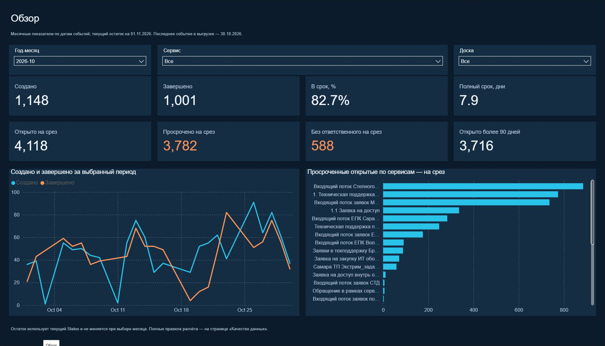
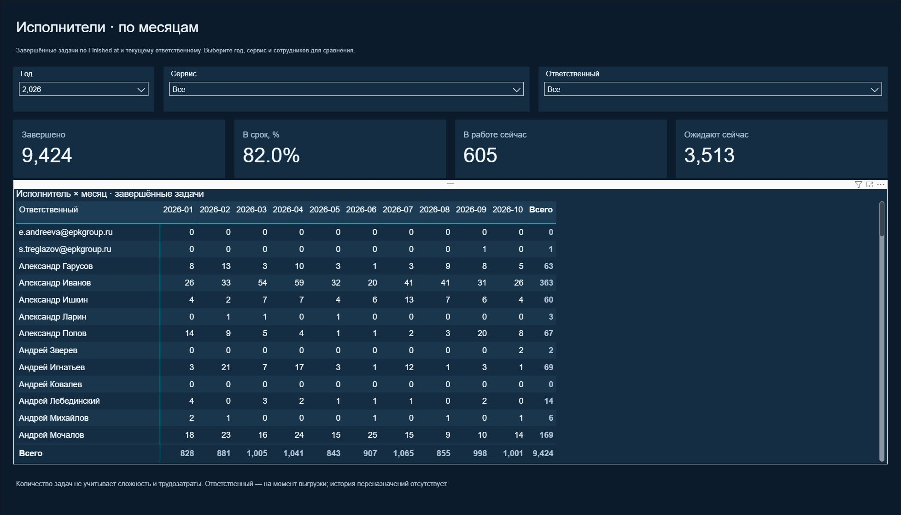

# EPK IT · Service Desk & Task Analytics

[← Danila Novikov · BI Portfolio](https://github.com/576e)

**Power BI · Power Query · DAX · Kaiten · Operational Reporting**

## Dashboard preview

### Overview



### Assignees by month



## Objective

Turn Kaiten exports into a management report that brings together request flow, completion times, the current backlog, and task distribution across services, boards, and assignees.

The report helps answer three practical questions: Are completions keeping pace with incoming requests? Where does overdue work accumulate? How does task volume change over time?

## My Contribution

At **EPK Information Technology**, I developed Power BI dashboards based on Kaiten exports to report on task completion and assigned workload. I clarified requirements with internal stakeholders, prepared data transformations and calculations, and built visualizations used in reporting to company management.

## Current Dashboard

| Page | Content |
| :--- | :--- |
| Overview | Created and completed requests, on-time completion, turnaround time, and current backlog indicators |
| Assignees by month | A monthly completion matrix, current work in progress, and queued tasks |
| Assignee comparisons | Completion counts, changes from the previous month, on-time completion, and turnaround times |
| Assignee trends | Monthly completion trends for selected assignees |
| Flow and turnaround | Incoming and completed requests, net inflow, average duration, median, and 90th percentile |
| Current backlog | Open and overdue requests, backlog age, unassigned tasks, and breakdowns by service and board |
| Services and assignees | Comparisons of request volume, completion times, and current queues |
| Request details | Individual request records with status, assignment, dates, age, and overdue flags |
| Data quality | Missing dates and assignments, status/date inconsistencies, and completeness checks |

Filters allow users to explore the relevant period, service, board, or assignee.

## Data Preparation & Model

- **Source:** a manually exported Kaiten CSV.
- **Preparation:** Power Query transformations and derived flags for status, deadlines, completion, and backlog age.
- **Model:** a requests table plus calendar, service, board, and assignee tables, with five relationships and 31 DAX measures.
- **Date logic:** requests created in a period use the creation date; completions and completion durations use the finish date.
- **Refresh:** update the source file and snapshot-date parameter, then refresh the report. The current version uses a saved data snapshot and manual refresh.

## DAX Example: Period Flow vs. Current Backlog

The completion measure activates the calendar relationship to the finish date. The backlog measure removes the calendar filter so that selecting a month does not turn the current snapshot into a misleading historical backlog.

The example retains the original model identifiers.

```dax
Завершено =
CALCULATE(
    COUNTROWS('Заявки'),
    'Заявки'[Завершена флаг] = 1,
    NOT ISBLANK('Заявки'[Завершена]),
    USERELATIONSHIP('Календарь'[Дата], 'Заявки'[Завершена])
)

Открыто на срез =
CALCULATE(
    SUM('Заявки'[Открыта]),
    REMOVEFILTERS('Календарь')
)
```

## Metric Definitions

- **Completed requests:** requests currently marked Done with a recorded finish date, counted in the period of completion.
- **Current backlog:** requests whose current status is not Done. It represents the export snapshot; historical backlog is not reconstructed.
- **Overdue share:** overdue open requests divided by open requests with a recorded due date. A missing due date does not count as overdue.
- **On-time completion:** completion on or before the due date, among completed requests with both dates recorded. This is a deadline-based metric; contractual SLA rules are not available.
- **Turnaround time:** calendar days from creation to completion. Time in progress runs from start to completion.
- **Assignee analysis:** uses the current Responsible field. Assignment history is unavailable, and task counts do not measure effort or individual performance.
- **Completed / created:** compares two flows within a period, rather than the conversion of one cohort, so it can exceed 100%.

## Outcome

A nine-page operational report that connects management KPIs with service and assignee breakdowns, request-level investigation, and data quality checks. It supports investigation of growing queues, overdue work, and changes in request flow.


## Open the dashboard

Download [the Power BI report](dashboard/EPK-IT-Service-Desk.pbix) and open it in Power BI Desktop. The PBIX includes the saved data model, so you can explore the existing snapshot without refreshing. Data refresh requires access to the original sources and may require updating source paths.

The report is presented as a portfolio project. It is not an official product of the named organization.


